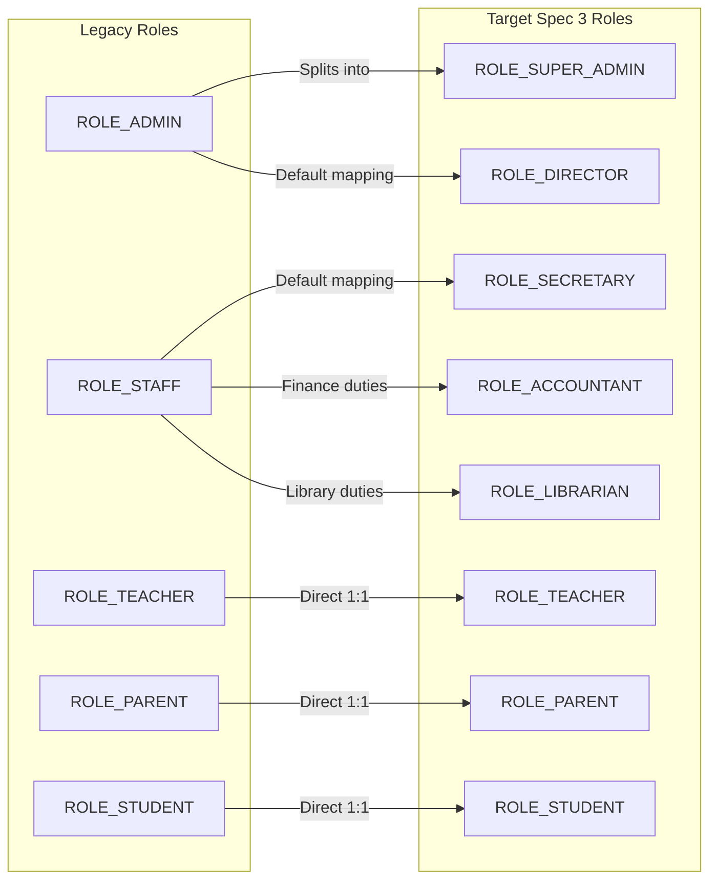

# Role-Based UI/UX Implementation Gaps & Migration Plan

**Project:** School Management Platform (*Système de Gestion Scolaire*)  
**Document:** Gap Inventory, Prioritization Matrix & Role Migration Plan  
**Target:** 8 Fully Functional Spec 3 Roles with shadcn new-york-v4 Dashboards and Grouped Sidebars  

---

## 1. Executive Summary of Gaps

While backend Flyway migrations `V19` and `V20` successfully seeded the 8 Spec 3 roles and 405+ `@PreAuthorize` endpoints in the Spring Boot API, the frontend remains partially tied to the legacy 5-role preview architecture.

Across the application, we identify:
* **P0 Blockers (Critical / Architectural):** 8 gaps
* **P1 Functional Gaps (High / Core Feature):** 11 gaps
* **P2 Polish & Enhancements (Medium / UX Excellence):** 6 gaps
* **Total Gaps:** 25 items

---

## 2. Comprehensive Gap Inventory

| Gap ID | Category | Priority | Effort | Wave Target | Description | Current Reality | Target Specification |
| :--- | :--- | :---: | :---: | :---: | :--- | :--- | :--- |
| **GAP-01** | Role Config | **P0** | **S** | Wave 10 | `knownRoles` in `authSessionUtils.js` incomplete | Only contains `['ROLE_ADMIN', 'ROLE_SUPER_ADMIN', 'ROLE_TEACHER', 'ROLE_STUDENT', 'ROLE_PARENT', 'ROLE_STAFF']`. Missing `ROLE_DIRECTOR`, `ROLE_SECRETARY`, `ROLE_ACCOUNTANT`, `ROLE_LIBRARIAN`, `ROLE_NURSE`. | Add all Spec 3 roles to `knownRoles` set and ensure `normalizeUser` preserves them. |
| **GAP-02** | Dashboard | **P0** | **M** | Wave 10 | Missing Dedicated `SuperAdminDashboard.jsx` | Super Admin sees `AdminDashboard.jsx` designed for school directors, with irrelevant student/teacher numbers. | Build dedicated multi-school platform dashboard: Schools count, global users, system health matrix, storage, login activity wave. |
| **GAP-03** | Dashboard | **P0** | **M** | Wave 10 | Missing Dedicated `DirectorDashboard.jsx` | Shares `AdminDashboard.jsx`; needs modern shadcn new-york-v4 styling with blue accents, real enrollment/attendance trends, and approval queues. | Refactor `AdminDashboard.jsx` into `DirectorDashboard.jsx` matching shadcn dashboard-01 specification. |
| **GAP-04** | Dashboard | **P0** | **M** | Wave 10 | Missing Dedicated `SecretaryDashboard.jsx` | Shares `StaffDashboard.jsx`; contains finance widgets that secretaries should not access. | Create `SecretaryDashboard.jsx` focused strictly on admissions queue, document checklist, absence justification review, and daily interviews. |
| **GAP-05** | Dashboard | **P0** | **M** | Wave 10 | Missing Dedicated `AccountantDashboard.jsx` | Accountants have no dashboard; defaults to admin view if assigned admin or 403. | Create `AccountantDashboard.jsx` with MTD revenue, unpaid balances, overdue accounts queue, cash-flow chart, and recent payment receipts. |
| **GAP-06** | Dashboard | **P0** | **S** | Wave 10 | Missing Dedicated `LibrarianDashboard.jsx` | Librarians have no dashboard; redirected to `/addons`. | Create `LibrarianDashboard.jsx` with catalog count, active loans, overdue returns, penalties due, and circulation desk queues. |
| **GAP-07** | Navigation | **P0** | **M** | Wave 10 | Parent Multi-Child Selector missing from Header | `ParentDashboard.jsx` has a local tab bar for children, but top header bar lacks persistent child selector for cross-page navigation. | Implement `ChildSelectorDropdown` in `PrivateLayout` header for `ROLE_PARENT` with context synchronization. |
| **GAP-08** | Route Guard | **P0** | **S** | Wave 10 | Route guards in `router.jsx` missing new role bindings | `/finances` lacks `ROLE_ACCOUNTANT`, `/admissions` lacks `ROLE_SECRETARY`, `/classes` lacks `ROLE_DIRECTOR` explicitly. | Update `allowedRoles` across all 46 routes in `router.jsx` to map to new roles and permissions. |
| **GAP-09** | Navigation | **P1** | **M** | Wave 11 | Static `navItems` in `PrivateLayout.jsx` | Hardcoded flat list in `PrivateLayout.jsx` with inline role filters instead of config-driven grouped sidebars. | Refactor `PrivateLayout.jsx` to load navigation from `role-ui-config.json` grouped into distinct sections with status badges. |
| **GAP-10** | Backend API | **P1** | **M** | Wave 11 | Missing Unified Badge Counts Endpoint | Badges must make multiple disjoint API calls or are hardcoded. | Implement `GET /api/v1/users/me/badge-counts` returning pending counts tailored to caller's role in a single call. |
| **GAP-11** | Backend API | **P1** | **M** | Wave 11 | Missing Super Admin Platform Stats Endpoint | No endpoint aggregating total schools, active tenants, and global storage. | Implement `GET /api/v1/admin/schools/stats` and `GET /api/v1/admin/system/storage`. |
| **GAP-12** | Backend API | **P1** | **S** | Wave 11 | Missing Teacher Live Attendance Status Endpoint | Teacher dashboard needs roll-call completion status for today's classes. | Implement `GET /api/v1/attendance/classes/teacher-today`. |
| **GAP-13** | Backend API | **P1** | **M** | Wave 11 | Missing Accountant Cash-Flow Chart API | Accountant cash-flow chart requires monthly revenue vs expenses aggregation. | Implement `GET /api/v1/reports/finance?groupBy=month`. |
| **GAP-14** | Pages | **P1** | **M** | Wave 11 | Missing Super Admin `/schools` Page | No UI for Super Admin to provision, view, edit, or suspend school tenants. | Build `SchoolsManagementPage.jsx` with school list, status pill, subscription dates, and new tenant modal. |
| **GAP-15** | Pages | **P1** | **M** | Wave 11 | Missing Super Admin `/system-health` Page | No dedicated visual health dashboard for API, MySQL, Redis, Celery, and mail services. | Build `SystemHealthPage.jsx` connecting to `/actuator/health` and Redis ping. |
| **GAP-16** | Pages | **P1** | **M** | Wave 11 | Missing Dedicated Overdue Invoices Page | Accountant sidebar lists `/finances/overdue`, currently handled by tabs inside `InvoicesPage.jsx`. | Extract or create dedicated `OverdueInvoicesPage.jsx` with direct escalation and reminder actions. |
| **GAP-17** | UI Design | **P1** | **M** | Wave 11 | Metric cards lack shadcn new-york-v4 styling & blue touches | Some cards use generic gray borders without signature blue accents or tabular numeric font alignment. | Update `StatCard.jsx` and dashboard cards to use `#2563EB` blue icons, trend pills, and `font-mono tabular-nums`. |
| **GAP-18** | Dashboard | **P1** | **S** | Wave 11 | Dashboard Role Switcher in `DashboardView.jsx` outdated | Preview bar only lists 5 legacy roles (`admin`, `teacher`, `student`, `parent`, `staff`). | Update preview switcher to support all 8 roles for testing and demo purposes. |
| **GAP-19** | Backend API | **P1** | **S** | Wave 11 | Missing Library Fines & Penalties Summary API | Librarian dashboard needs quick fine aggregation endpoint. | Implement `GET /api/v1/library/penalties/summary`. |
| **GAP-20** | UI Design | **P2** | **M** | Wave 12 | Collapsible Sidebar Icon Rail (64px) | Sidebar collapses on mobile but is fixed 256px on desktop without mini-rail mode. | Add 64px desktop icon-rail collapse mode with floating tooltip previews on hover. |
| **GAP-21** | UI Feature | **P2** | **M** | Wave 12 | Global Command Palette (`⌘K` / `Ctrl+K`) | Keyboard navigation exists for `Ctrl+S`, but no fast route switcher command bar. | Implement shadcn-style `CommandPalette` modal for rapid page jumps and search. |
| **GAP-22** | UX Polish | **P2** | **S** | Wave 12 | Standardized Widget Empty States | Empty widgets sometimes show empty space or raw text without icon/action. | Wire all dashboard widgets to unified `EmptyState` component with contextual primary blue action. |
| **GAP-23** | UX Polish | **P2** | **S** | Wave 12 | RTL Layout Mirroring for Arabic | Arabic text works, but some icons (e.g. arrows, chevrons) and margin offsets are not fully mirrored. | Audit and apply logical Tailwind utilities (`ps-*`, `pe-*`, `rtl:rotate-180`) across all dashboard widgets. |
| **GAP-24** | UX Polish | **P2** | **S** | Wave 12 | Skeleton Loaders for Dashboard Grid | Loading shows generic spinner; should show card skeletons matching shadcn dashboard-01 layout. | Implement `DashboardSkeleton.jsx` with 4 card skeletons and 2 chart skeletons. |
| **GAP-25** | Data Sync | **P2** | **M** | Wave 12 | Real-time WebSocket Dashboard Event Invalidation | Dashboard requires manual refresh or polling. | Wire STOMP WebSocket client to invalidate dashboard React Query / SWR caches upon attendance, grade, or invoice events. |

---

## 3. Gap Analysis Summary by Priority & Effort

### Priority Breakdown
| Priority Level | Count | Description | Target Wave |
| :--- | :---: | :--- | :---: |
| **P0 (Critical)** | **8** | Role definitions, dedicated dashboards, child switcher, route guards | Wave 10 |
| **P1 (High)** | **11** | Config-driven navigation, badge counters, missing pages, API endpoints | Wave 11 |
| **P2 (Medium)** | **6** | Icon-rail collapse, command palette, skeleton loaders, WebSocket sync | Wave 12 |
| **TOTAL** | **25** | Full production completeness | Waves 10–12 |

### Effort Breakdown
| Effort Size | Count | Estimated Time / Scope |
| :--- | :---: | :--- |
| **Small (S)** | **8** | Under 2 hours; configuration updates, route additions, minor component adjustments |
| **Medium (M)** | **17** | 2–6 hours; full dashboard components, pages, backend endpoints, UI refactors |
| **Large (L)** | **0** | No high-risk architectural rewrites required (Flyway and security backbone are in place) |

---

## 4. Role Migration Plan (Legacy -> Target 8 Roles)

### 4.1 Role Mapping Strategy



### 4.2 Migration Rules & Risk Mitigation

1. **Database Backward Compatibility:**
   * In Flyway `V19`, roles 7 (`ROLE_SUPER_ADMIN`), 8 (`ROLE_DIRECTOR`), 9 (`ROLE_SECRETARY`), and 10 (`ROLE_ACCOUNTANT`) were inserted into the `roles` table.
   * Existing users with `ROLE_ADMIN`:
     - Users flagged as `is_system_owner = true` or `email LIKE '%superadmin%'` receive `ROLE_SUPER_ADMIN`.
     - All other current administrators retain `ROLE_ADMIN` and are automatically granted `ROLE_DIRECTOR` privileges via Spring Security role hierarchy:
       ```java
       // Role hierarchy bean in SecurityConfig
       roleHierarchy.setHierarchy("ROLE_SUPER_ADMIN > ROLE_DIRECTOR > ROLE_ADMIN\n" +
                                  "ROLE_DIRECTOR > ROLE_SECRETARY\n" +
                                  "ROLE_DIRECTOR > ROLE_ACCOUNTANT\n" +
                                  "ROLE_DIRECTOR > ROLE_STAFF");
       ```
   * Existing users with `ROLE_STAFF`:
     - Assigned `ROLE_SECRETARY` by default.
     - Staff members with finance job titles are mapped to `ROLE_ACCOUNTANT`.

2. **Frontend Token & Session Graceful Degradation:**
   * `authSessionUtils.js` will normalize legacy roles:
     - If `user.roles` contains `ROLE_ADMIN`, frontend evaluates both `hasRole('ROLE_ADMIN')` and `hasRole('ROLE_DIRECTOR')` as true.
     - If `user.roles` contains `ROLE_STAFF`, frontend evaluates both `hasRole('ROLE_STAFF')` and `hasRole('ROLE_SECRETARY')` as true.
   * This guarantees that existing active sessions continue working without forced logout during rollout.

3. **Risk Matrix & Rollback Plan:**
   * *Risk 1 (Role ambiguity during transition):* Handled by alias evaluation in `AuthProvider.jsx`.
   * *Risk 2 (Permission denial on old endpoints):* Handled by granting `@PreAuthorize("hasAnyRole('ADMIN', 'DIRECTOR')")` on all administrative endpoints.
   * *Rollback:* Database migrations are additive (no tables or columns dropped). Reverting frontend git commit immediately restores legacy 5-role behavior without database rollback.
