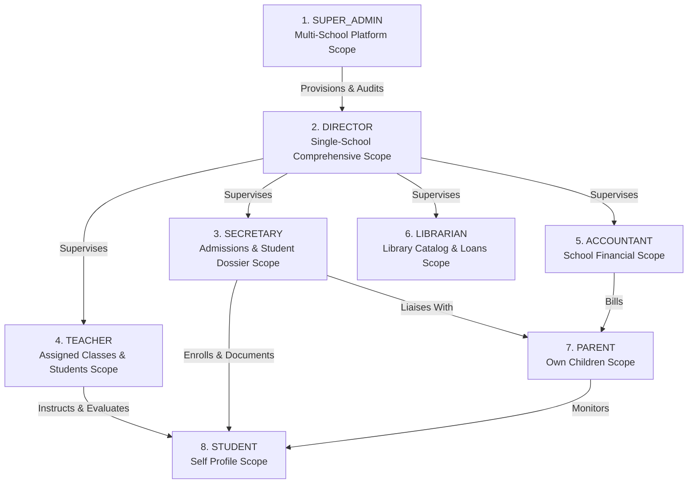

# Role-Based Sidebars and Dashboards Specification (UI/UX Spec)

**Project:** School Management Platform (*Système de Gestion Scolaire*)  
**Stack:** Spring Boot 3.4 API (REST, Method Security) + React 19/Vite SPA + Tailwind CSS + Frappe / ERPNext Desk UI + shadcn/ui new-york-v4  
**Design Reference:** [shadcn/ui new-york-v4 dashboard-01](https://ui.shadcn.com/view/new-york-v4/dashboard-01) with signature Blue touches (`#2563EB`) and Frappe Desk UI density  
**Sources of Truth:** `docs/spec.pdf` (Section 3 Roles, Section 5.3 Dashboards, Section 5.4 Common Pages, Modules 4.1–4.18), `AUDIT_REPORT_v2.md`, `REMEDIATION_LOG.md`, `docs/permissions-matrix.md`  
**Status:** DESIGN ONLY — Phase 1 Architecture (Awaiting `GO IMPLEMENT` signal)  

---

## 1. Executive Summary & Situation

### 1.1 Context & Reality Check
The school management platform handles all daily operations of educational institutions. While the functional specification (`docs/spec.pdf` Section 3) explicitly defines **8 primary user roles**, the frontend codebase initially operated with a simplified 5-role preview switcher (`admin`, `teacher`, `student`, `parent`, `staff`).

In Wave 8 and Wave 9, backend Flyway migrations `V19` and `V20` introduced the full Spec 3 role model in the database (`ROLE_SUPER_ADMIN`, `ROLE_DIRECTOR`, `ROLE_SECRETARY`, `ROLE_ACCOUNTANT`, `ROLE_LIBRARIAN`, `ROLE_NURSE`), but the frontend navigation and dashboard layers remain partially consolidated (e.g., `AdminDashboard` serves both Director and Super Admin, `StaffDashboard` serves Secretary and Staff, while Accountant and Librarian lack dedicated views).

This specification resolves the gap. It establishes:
1. **8 Role-Specific Sidebars:** Config-driven, grouped, permission-gated navigation with real badge counters.
2. **8 Role-Specific Dashboards:** High-density, actionable layouts modeled directly on **shadcn/ui new-york-v4 dashboard-01** with signature blue accents (`#2563EB`).
3. **Strict Data Scope & Security Matrix:** Mapping every widget, quick action, and page action to exact backend permissions and SpEL ownership expressions.
4. **Shared Common Surface (Spec 5.4):** Unified profile, document locker, notification center, direct messaging, and calendar.

---

## 2. UI/UX Design System Specification

### 2.1 Aesthetic Foundation: shadcn new-york-v4 + "Touch of Blue" + Frappe Desk UI
The application combines the clean, micro-bordered, modern aesthetic of **shadcn/ui new-york-v4 dashboard-01** with the functional data density and keyboard-first ergonomics of the **Frappe / ERPNext Desk UI**:

* **Color Palette & Design Tokens:**
  - **Base Canvas:** Neutral cool slate `#F8FAFC` (`bg-slate-50/60`), dark mode `#090D16`.
  - **Cards & Surfaces:** Pure white `#FFFFFF` (`bg-white`), dark mode `#111827`, subtle micro-borders `border border-slate-200/80` (`#E2E8F0`).
  - **Touch of Blue (Signature Accent):**
    - Primary Action / Buttons: `#2563EB` (Tailwind `blue-600`), hover `#1D4ED8` (`blue-700`).
    - Focus Rings & Active Borders: `#3B82F6` (`blue-500`), focus ring `ring-2 ring-blue-500/20`.
    - Active Navigation Background: Subtle blue wash `#EFF6FF` (`blue-50/80`) with `#1D4ED8` (`blue-700`) typography.
    - KPI Trend & Visual Highlights: Soft blue badges `#DBEAFE` (`blue-100`) with `#1E40AF` (`blue-800`) text, gradient area chart fills (`rgba(37, 99, 235, 0.12)` fading to transparent).
  - **Semantic States:**
    - Success / Paid / Present: Emerald `#059669` / `#ECFDF5`.
    - Warning / Pending / Late: Amber `#D97706` / `#FFFBEB`.
    - Danger / Overdue / Absent: Rose `#E11D48` / `#FFF1F2`.
    - Neutral / Draft: Slate `#64748B` / `#F1F5F9`.

* **Typography & Density (Frappe Desk Standards):**
  - Font Family: Inter / Geist / System Sans (`font-sans`).
  - Tabular Numbers: `font-mono tabular-nums` for all KPI values, percentages, amounts, and dates to ensure visual alignment.
  - Scale:
    - Micro Labels / Badges: `text-[10px]` or `text-2xs` (`11px`), `font-semibold`, uppercase tracking `tracking-wider`.
    - Regular Body / Inputs: `text-xs` (`12px`) to `text-sm` (`13px`).
    - Section Headers / Card Titles: `text-xs font-semibold text-slate-500 uppercase`.
    - KPI Values: `text-2xl font-bold tracking-tight text-slate-900`.
    - Page Titles: `text-xl font-bold text-slate-900 tracking-tight`.

* **Component Structure (DocType & Dashboard Uniformity):**
  - **DocType Page Header (`DocTypePageHead`):** Top sticky bar with breadcrumbs, entity title, status pill (`Draft`, `Submitted`, `Approved`, `Active`), and primary blue action button.
  - **Sidebar Navigation:** Collapsible (256px expanded / 64px icon rail), grouped by functional modules, active indicator with blue accent pill and counter badge.
  - **Stat Cards (Row 1):** 4-card grid with title, icon in blue-tinted container, bold metric, and trend delta pill (`+12.5% from last month`).
  - **Visual Data Grid (Row 2):** Main chart card (7–8 columns) + secondary breakdown or quick activity card (4–5 columns).
  - **Data Tables & Queues (Row 3):** High-density child tables with subtle borders, status badges, and quick row actions.

---

## 3. Detailed Role Specifications (8 Roles)

---

### ROLE 1: SUPER_ADMIN (Platform Owner)

#### A. Purpose & Scope
* **Scope:** Global platform owner. Cross-tenant authority across all schools, platform tenant provisioning, system health monitoring, global security audit logs, database backups, and RBAC permission definitions.
* **Data Boundary:** Global (`ALL_SCHOOLS`).

#### B. Sidebar Navigation
*Grouped into 3 sections:*

| Section | Item Label (Key) | Icon | Route | Required Permission | Status | Badge Source |
| :--- | :--- | :--- | :--- | :--- | :--- | :--- |
| **MAIN** | `nav.overview` | `LayoutDashboard` | `/dashboard` | `system:monitor` | EXISTS | — |
| **PLATFORM** | `nav.schools` | `Building2` | `/schools` | `school:manage` | MISSING page | Total active schools |
| **PLATFORM** | `nav.users` | `Users` | `/users` | `user:read` | MISSING page | Total pending users |
| **PLATFORM** | `nav.rolesPermissions` | `ShieldCheck` | `/settings` | `role:manage` | EXISTS (Settings tab) | — |
| **SYSTEM** | `nav.globalSettings` | `Sliders` | `/settings` | `system:config` | EXISTS | — |
| **SYSTEM** | `nav.auditLogs` | `ShieldAlert` | `/audit-logs` | `audit:read` | EXISTS | Today's alert count |
| **SYSTEM** | `nav.systemHealth` | `Activity` | `/system-health` | `system:monitor` | MISSING page | Critical health flag |
| **SYSTEM** | `nav.backups` | `Database` | `/settings` | `system:backup` | EXISTS (Settings tab) | Failed backups count |

#### C. Dashboard Layout (shadcn dashboard-01)
* **Header:** Title "Platform Operations Center", subtitle "Multi-School Engine & Infrastructure Status", Quick Action buttons.
* **Row 1 — 4 KPI Stat Cards:**
  1. *Total Active Schools:* KPI Card | Endpoint: `GET /v1/admin/schools/stats` | Refresh: 60s | Click-through: `/schools` | Perm: `school:manage`.
  2. *Total Registered Users:* KPI Card | Endpoint: `GET /v1/users/stats` | Refresh: 60s | Click-through: `/users` | Perm: `user:read`.
  3. *API & Service Uptime:* KPI Card (99.98%) | Endpoint: `GET /actuator/health` | Refresh: 30s | Click-through: `/system-health` | Perm: `system:monitor`.
  4. *Storage & DB Utilization:* KPI Card | Endpoint: `GET /v1/admin/system/storage` | Refresh: 300s | Click-through: `/settings` | Perm: `system:monitor`.
* **Row 2 — Visual Analytics (12-Col Grid):**
  - *Main Chart (Col 1–8):* Global User Activity & Login Wave Chart (Area chart with blue gradient fill) | Endpoint: `GET /v1/audit-logs/metrics/logins` | Filters: 24h, 7d, 30d | Perm: `audit:read`.
  - *Secondary Card (Col 9–12):* Services Health Matrix (API, MySQL, Redis, Celery/Worker, Mailpit, S3) | Endpoint: `GET /actuator/health` | Status pills with green/amber/red indicators | Perm: `system:monitor`.
* **Row 3 — Tables & Activity:**
  - *Left (Col 1–7):* Critical Security Audit Events | Endpoint: `GET /api/audit-logs?severity=HIGH&size=6` | Perm: `audit:read`.
  - *Right (Col 8–12):* Automated Database Backup Runs | Endpoint: `GET /v1/admin/backups?size=5` | Perm: `system:backup`.

#### D. Quick Actions
1. `+ Provision New School` (`Building2`, Primary Blue, modal `/schools/new`, Perm: `school:manage`).
2. `Backup Database Now` (`Database`, Outline, trigger `POST /v1/admin/backups/trigger`, Perm: `system:backup`).
3. `Security Scan / Audit` (`ShieldAlert`, Outline, route `/audit-logs`, Perm: `audit:read`).
4. `Flush Redis Cache` (`RefreshCw`, Danger Outline, trigger `POST /v1/admin/cache/clear`, Perm: `system:config`).

#### E. Per-Page Capabilities
* `/schools`: View, Create, Edit, Suspend school tenant.
* `/users`: View all users across schools, reset credentials, deactivate.
* `/settings`: Edit global parameters, manage RBAC matrix, trigger DB backups.
* `/audit-logs`: View and export immutable security logs across all institutions.

#### F. Explicitly Forbidden
* Cannot view individual student grades, teacher observations, or parent financial receipts (separation of platform operations and pedagogical confidentiality).
* Cannot modify student report cards or change class schedules.

#### G. Notifications Received
* Database backup failure alerts (`CRITICAL`).
* JWT/HMAC security exception alerts or brute-force lockouts (`HIGH`).
* Redis cache or database connection degradation (`HIGH`).

---

### ROLE 2: DIRECTOR (School Administrator)

#### A. Purpose & Scope
* **Scope:** Full executive and academic control of one school institution. Manages pedagogical structures, admissions, faculty/staff, exams, budgets, schedules, compliance, and school branding.
* **Data Boundary:** Single School Institutional (`SCHOOL_WIDE`).

#### B. Sidebar Navigation
*Grouped into 4 sections:*

| Section | Item Label (Key) | Icon | Route | Required Permission | Status | Badge Source |
| :--- | :--- | :--- | :--- | :--- | :--- | :--- |
| **MAIN** | `nav.dashboard` | `LayoutDashboard` | `/dashboard` | `dashboard:director:read` | EXISTS | — |
| **ACADEMICS** | `nav.students` | `GraduationCap` | `/students` | `student:read` | EXISTS | Total active count |
| **ACADEMICS** | `nav.academicYears` | `Calendar` | `/academic-years` | `academics:manage` | EXISTS | — |
| **ACADEMICS** | `nav.classes` | `School` | `/classes` | `class:read` | EXISTS | — |
| **ACADEMICS** | `nav.subjects` | `BookOpen` | `/subjects` | `subject:read` | EXISTS | — |
| **ACADEMICS** | `nav.timetables` | `Calendar` | `/timetables` | `timetable:read` | EXISTS | Double-booking alerts |
| **ACADEMICS** | `nav.attendance` | `CalendarCheck` | `/attendance` | `attendance:read` | EXISTS | Today's unexcused absences |
| **ACADEMICS** | `nav.examsGrades` | `Award` | `/grades` | `grade:read` | EXISTS | Pending locks |
| **ACADEMICS** | `nav.reportCards` | `FileText` | `/report-cards` | `reportcard:read` | EXISTS | Unissued report cards |
| **ADMIN & STAFF** | `nav.admissions` | `ClipboardCheck` | `/admissions` | `application:read` | EXISTS | Pending candidate apps |
| **ADMIN & STAFF** | `nav.teachers` | `UserCheck` | `/teachers` | `teacher:read` | EXISTS | — |
| **ADMIN & STAFF** | `nav.staff` | `Briefcase` | `/staff` | `staff:read` | EXISTS | Pending leave requests |
| **ADMIN & STAFF** | `nav.departments` | `Building2` | `/departments` | `department:read` | EXISTS | — |
| **FINANCE & OPS** | `nav.finances` | `CreditCard` | `/finances/invoices` | `finance:read` | EXISTS | Overdue invoice count |
| **FINANCE & OPS** | `nav.reports` | `BarChart3` | `/reports` | `report:read` | EXISTS | — |
| **FINANCE & OPS** | `nav.aiAnalyses` | `Brain` | `/analyses` | `ai:validate` | EXISTS | AI analyses pending review |
| **FINANCE & OPS** | `nav.addons` | `Sparkles` | `/addons` | `addon:read` | EXISTS | — |
| **FINANCE & OPS** | `nav.settings` | `Sliders` | `/settings` | `school:configure` | EXISTS | — |

#### C. Dashboard Layout (shadcn dashboard-01)
* **Header:** Title "Executive School Dashboard", subtitle "Academic Year 2026–2027 • Active Term 2", Quick Actions row.
* **Row 1 — 4 KPI Stat Cards:**
  1. *Total Enrolled Students:* Value (e.g. `1,248`), Subtitle `98% Capacity`, Badge `+4.5% vs LY` | Endpoint: `GET /v1/reports/enrollment?summary=true` | Perm: `student:read`.
  2. *Daily Attendance Rate:* Value (e.g. `96.2%`), Subtitle `47 Absences today`, Badge `+0.8%` | Endpoint: `GET /v1/attendance/classes/daily-rate` | Perm: `attendance:read`.
  3. *Tuition Collection Rate:* Value (e.g. `$248.5K`), Subtitle `82% Collected ($42K Overdue)`, Badge `+12.4%` | Endpoint: `GET /v1/finances/invoices/accounting-summary` | Perm: `finance:read`.
  4. *Faculty Workload & Presence:* Value (e.g. `64/64 Teachers Active`), Subtitle `2 on Approved Leave`, Badge `Optimal` | Endpoint: `GET /v1/staff/evaluations/summary` | Perm: `staff:read`.
* **Row 2 — Visual Analytics (12-Col Grid):**
  - *Main Chart (Col 1–8):* Attendance & Enrollment Trends (Stacked Area chart with blue and slate gradients) | Endpoint: `GET /v1/reports/attendance?groupBy=month` | Filters: Daily, Weekly, Term | Perm: `report:read`.
  - *Secondary Card (Col 9–12):* Academic Performance Distribution (Grade breakdown donut/radial: Excellent, Good, Average, At Risk) | Endpoint: `GET /v1/reports/academic?summary=true` | Perm: `report:read`.
* **Row 3 — Actionable Decision Queues:**
  - *Left (Col 1–6):* Pending Admissions & Registration Queue | Endpoint: `GET /v1/applications?status=PENDING&size=5` | Status pill + Quick Approve button | Perm: `application:write`.
  - *Right (Col 7–12):* Administrative Validations (Teacher leave requests, AI pedagogical analyses awaiting publication) | Endpoint: `GET /api/leave-requests?status=PENDING` | Perm: `staff:manage`.

#### D. Quick Actions
1. `+ New Student Admission` (`UserPlus`, Primary Blue, modal `/admissions/new`, Perm: `application:write`).
2. `Publish Official Bulletin` (`FileText`, Outline, route `/report-cards`, Perm: `reportcard:publish`).
3. `Trigger Overdue Reminders` (`Send`, Outline, trigger `POST /v1/finances/invoices/trigger-overdue-reminders`, Perm: `finance:write`).
4. `School Configuration` (`Sliders`, Outline, route `/settings`, Perm: `school:configure`).

#### E. Per-Page Capabilities
* Full CRUD and Approval authority on all academic, staffing, admissions, financial, and pedagogical modules within their school.
* Export authority for CSV and OpenPDF on all reports.

#### F. Explicitly Forbidden
* Cannot access or modify other institutions' school profiles or student dossiers.
* Cannot modify platform-level Spring Boot security parameters or encryption keys.

#### G. Notifications Received
* High absence spikes or disciplinary incidents.
* Pending staff leave requests and resignation/contract alerts.
* Daily financial summary and overdue invoice escalation thresholds.
* Pedagogical AI analyses ready for executive validation.

---

### ROLE 3: SECRETARY (Scolarité & Registrariat)

#### A. Purpose & Scope
* **Scope:** Day-to-day administrative engine. Student dossier registration, admissions workflow processing, document verification, enrollment certificates, student ID cards, absence justification processing, and parent appointment coordination.
* **Data Boundary:** School Administrative Dossiers (`SCHOOL_WIDE_STUDENT_DATA`).

#### B. Sidebar Navigation
*Grouped into 3 sections:*

| Section | Item Label (Key) | Icon | Route | Required Permission | Status | Badge Source |
| :--- | :--- | :--- | :--- | :--- | :--- | :--- |
| **MAIN** | `nav.dashboard` | `LayoutDashboard` | `/dashboard` | `dashboard:secretary:read` | EXISTS | — |
| **REGISTRAR** | `nav.admissions` | `ClipboardCheck` | `/admissions` | `application:read` | EXISTS | New applications count |
| **REGISTRAR** | `nav.students` | `GraduationCap` | `/students` | `student:read` | EXISTS | Total student count |
| **REGISTRAR** | `nav.guardians` | `Users` | `/guardians` | `guardian:read` | EXISTS | — |
| **REGISTRAR** | `nav.documentsVerify` | `FileCheck` | `/students` | `document:verify` | EXISTS (Compliance tab) | Pending documents to verify |
| **REGISTRAR** | `nav.certificatesId` | `CreditCard` | `/students` | `certificate:generate` | EXISTS (Action menu) | Ready for print |
| **SCOLARITÉ** | `nav.attendanceJustif` | `CalendarCheck` | `/attendance` | `attendance:justify` | EXISTS (Justifications tab) | Pending justifications count |
| **SCOLARITÉ** | `nav.parentMeetings` | `Calendar` | `/events` | `meeting:manage` | EXISTS (Bookings tab) | Today's scheduled visits |
| **COMMUNICATION** | `nav.announcements` | `Megaphone` | `/announcements` | `announcement:write` | EXISTS | — |
| **COMMUNICATION** | `nav.messages` | `Mail` | `/messages` | `message:send` | EXISTS | Unread inbox count |

#### C. Dashboard Layout (shadcn dashboard-01)
* **Header:** Title "Secretariat & Admissions Office", subtitle "Student Dossiers & Daily Administrative Processing", Quick Action buttons.
* **Row 1 — 4 KPI Stat Cards:**
  1. *New Applications to Review:* Value (e.g. `24`), Subtitle `8 Interviews scheduled today`, Badge `Urgent` | Endpoint: `GET /v1/applications?status=PENDING` | Perm: `application:read`.
  2. *Legal Documents Pending Verification:* Value (e.g. `38`), Subtitle `Medical & Birth certificates`, Badge `Review required` | Endpoint: `GET /v1/documents/checklist?status=PENDING` | Perm: `document:verify`.
  3. *Unexcused Absences Requiring Proof:* Value (e.g. `14`), Subtitle `Parent notes pending`, Badge `Action` | Endpoint: `GET /v1/attendance/justifications?status=PENDING` | Perm: `attendance:justify`.
  4. *Scheduled Parent Interviews Today:* Value (e.g. `6`), Subtitle `Next at 10:30 AM`, Badge `Scheduled` | Endpoint: `GET /v1/meetings/bookings?date=today` | Perm: `meeting:manage`.
* **Row 2 — Visual Operations Queue (12-Col Grid):**
  - *Main Table (Col 1–8):* Candidate Application Processing Pipeline (Name, Grade Level, Applied Date, Documents Complete %, Status, Action buttons: Review / Schedule Test / Accept) | Endpoint: `GET /v1/applications?size=6` | Perm: `application:read`.
  - *Secondary Card (Col 9–12):* Missing Documents Compliance Checklist by Class | Endpoint: `GET /v1/documents/checklist` | Progress bars indicating completed dossiers | Perm: `document:verify`.
* **Row 3 — Today's Front Desk Worklist:**
  - *Left (Col 1–7):* Absence Justification Documents to Validate | Endpoint: `GET /v1/attendance/justifications?status=PENDING&size=5` | Perm: `attendance:justify`.
  - *Right (Col 8–12):* Today's Parent Appointments & Visitor Badges | Endpoint: `GET /v1/meetings/bookings?date=today` | Perm: `meeting:manage`.

#### D. Quick Actions
1. `+ Register Candidate Dossier` (`UserPlus`, Primary Blue, modal `/admissions/new`, Perm: `application:write`).
2. `Generate School Certificate` (`FileText`, Outline, modal `/students/certificate`, Perm: `certificate:generate`).
3. `Print Student ID Cards` (`CreditCard`, Outline, modal `/students/id-cards`, Perm: `certificate:generate`).
4. `Post School Announcement` (`Megaphone`, Outline, modal `/announcements/new`, Perm: `announcement:write`).

#### E. Per-Page Capabilities
* `/students`: View dossiers, edit contact/emergency info, upload legal documents, print ID card & attendance certificates. CANNOT edit grades or medical diagnosis notes.
* `/admissions`: Create candidate, progress pipeline, record entrance interview/test score, convert accepted candidates to students.
* `/attendance`: Review and approve/reject parent absence justifications (transitions attendance record to `EXCUSED`).
* `/documents`: Verify, approve, or reject uploaded identity and medical clearance documents.

#### F. Explicitly Forbidden
* CANNOT view or edit student exam grades or report card marks.
* CANNOT view school accounting ledgers, expenses, or financial profit/loss reports.
* CANNOT access confidential teacher disciplinary notes or infirmary clinical treatment logs.

#### G. Notifications Received
* New online candidate application submitted.
* New parent absence justification or medical document uploaded.
* Parent appointment booking request submitted.

---

### ROLE 4: TEACHER (Enseignant)

#### A. Purpose & Scope
* **Scope:** Classroom instruction and student academic development. Daily roll-call attendance, exam and test scheduling, grade entry, homework assignment & submission grading, course resource sharing, pedagogical observations, and parent appointments.
* **Data Boundary:** Strictly Scoped to Assigned Classes and Students (`OWN_CLASSES_AND_STUDENTS`).

#### B. Sidebar Navigation
*Grouped into 3 sections:*

| Section | Item Label (Key) | Icon | Route | Required Permission | Status | Badge Source |
| :--- | :--- | :--- | :--- | :--- | :--- | :--- |
| **MAIN** | `nav.dashboard` | `LayoutDashboard` | `/dashboard` | `dashboard:teacher:read` | EXISTS | — |
| **TEACHING** | `nav.myTimetable` | `Calendar` | `/timetables` | `timetable:teacher:read` | EXISTS | Next class indicator |
| **TEACHING** | `nav.myClasses` | `School` | `/classes` | `class:teacher:read` | EXISTS | Total classes taught |
| **TEACHING** | `nav.rollCall` | `CalendarCheck` | `/attendance` | `attendance:write` | EXISTS | Roll-call pending badge |
| **TEACHING** | `nav.examsGrades` | `Award` | `/grades` | `grade:write` | EXISTS | Unlocked exams count |
| **TEACHING** | `nav.homework` | `BookOpen` | `/homework` | `homework:write` | EXISTS | Submissions to grade |
| **TEACHING** | `nav.coursesResources` | `FileText` | `/homework` | `course:manage` | EXISTS (Course Space tab) | — |
| **PEDAGOGY** | `nav.observations` | `Eye` | `/observations` | `observation:write` | EXISTS | Draft observations |
| **PEDAGOGY** | `nav.aiAnalyses` | `Brain` | `/analyses` | `ai:validate` | EXISTS | Analyses awaiting validation |
| **COMMUNICATION** | `nav.parentMeetings` | `Calendar` | `/events` | `meeting:teacher:manage` | EXISTS (Bookings tab) | Upcoming meetings |
| **COMMUNICATION** | `nav.messages` | `Mail` | `/messages` | `message:send` | EXISTS | Unread messages |
| **COMMUNICATION** | `nav.announcements` | `Megaphone` | `/announcements` | `announcement:read` | EXISTS | — |

#### C. Dashboard Layout (shadcn dashboard-01)
* **Header:** Title "Teacher Workstation", subtitle `Prof. [Last Name] • [Department Name]`, Quick Action buttons.
* **Row 1 — 4 KPI Stat Cards:**
  1. *Today's Assigned Classes:* Value (e.g. `4 Classes`), Subtitle `Next: 10:00 AM • 3ème B (Maths)`, Badge `In 25m` | Endpoint: `GET /v1/timetables/calendar?date=today` | Perm: `timetable:teacher:read`.
  2. *Roll Call Completion:* Value (e.g. `1/4 Completed`), Subtitle `3 Sessions pending roll-call`, Badge `Action Required` | Endpoint: `GET /v1/attendance/classes/teacher-today` | Perm: `attendance:write`.
  3. *Homework Submissions to Grade:* Value (e.g. `18 Submissions`), Subtitle `Algebra Assignment 4`, Badge `Pending` | Endpoint: `GET /v1/homework/submissions?graded=false` | Perm: `homework:write`.
  4. *Pedagogical AI Analyses for Validation:* Value (e.g. `3 Analyses`), Subtitle `End of term drafts ready`, Badge `Review` | Endpoint: `GET /api/ai-analyses?status=DRAFT` | Perm: `ai:validate`.
* **Row 2 — Teaching Schedule & Live Roll-Call (12-Col Grid):**
  - *Main Card (Col 1–7):* Today's Timetable & Instant Roll-Call Trigger (Chronological slot cards with Subject, Room, Class, and one-click "Take Attendance" button) | Endpoint: `GET /v1/timetables/calendar?date=today` | Perm: `timetable:teacher:read`.
  - *Secondary Card (Col 8–12):* Quick Grade Entry & Exam Progress (List of recent tests with average score and lock status) | Endpoint: `GET /v1/exams?myExams=true&size=5` | Perm: `grade:write`.
* **Row 3 — Pedagogical Follow-up:**
  - *Left (Col 1–6):* Student Observations Requiring Attention (Recent behavioral/academic observation notes) | Endpoint: `GET /api/observations?myStudents=true&size=5` | Perm: `observation:read`.
  - *Right (Col 7–12):* Upcoming Parent Appointments | Endpoint: `GET /v1/meetings/bookings?teacherId=me&size=4` | Perm: `meeting:teacher:manage`.

#### D. Quick Actions
1. `Take Class Attendance` (`CalendarCheck`, Primary Blue, route `/attendance`, Perm: `attendance:write`).
2. `+ Create Exam / Test` (`Award`, Outline, modal `/exams/new`, Perm: `grade:write`).
3. `+ Assign Homework` (`BookOpen`, Outline, modal `/homework/new`, Perm: `homework:write`).
4. `Write Observation` (`Eye`, Outline, modal `/observations/new`, Perm: `observation:write`).

#### E. Per-Page Capabilities
* `/attendance`: Conduct roll-call, mark Present, Absent, Late, or Excused for assigned classes.
* `/grades`: Create evaluations for own classes/subjects, bulk enter numeric grades, view grade distribution, lock grades.
* `/homework`: Create homework tasks with file attachments, review online student submissions, assign feedback and marks.
* `/observations`: Author pedagogical observations on students enrolled in their classes.
* `/analyses`: Review, edit, validate, and publish AI-generated pedagogical reports.

#### F. Explicitly Forbidden
* CANNOT view or edit grades in classes or subjects they do not teach.
* CANNOT access student tuition payment records, invoices, or parent financial balances.
* CANNOT view teacher salaries, peer leave records, or administrative staff evaluations.

#### G. Notifications Received
* Parent absence justifications submitted for students in their classes.
* Homework submitted by students before/after deadlines.
* Parent-teacher appointment bookings or cancellations.
* AI pedagogical analyses generated and awaiting validation.

---

### ROLE 5: ACCOUNTANT (Comptable & Gestionnaire Financier)

#### A. Purpose & Scope
* **Scope:** School financial operations. Tuition fee configuration, discount rules, automated invoice generation, installment management, payment processing, expense recording, overdue tracking, and financial analytics.
* **Data Boundary:** School Financial Operations (`FINANCIAL_LEDGER_ONLY`).

#### B. Sidebar Navigation
*Grouped into 3 sections:*

| Section | Item Label (Key) | Icon | Route | Required Permission | Status | Badge Source |
| :--- | :--- | :--- | :--- | :--- | :--- | :--- |
| **MAIN** | `nav.dashboard` | `LayoutDashboard` | `/dashboard` | `dashboard:accountant:read` | EXISTS | — |
| **BILLING** | `nav.invoices` | `CreditCard` | `/finances/invoices` | `invoice:read` | EXISTS | Unpaid invoice count |
| **BILLING** | `nav.payments` | `Receipt` | `/finances/payments` | `payment:read` | EXISTS | Today's transactions |
| **BILLING** | `nav.feeTypesDiscounts` | `Percent` | `/finances/fee-types` | `fee:manage` | EXISTS (Discounts tab) | Active discount rules |
| **COLLECTION** | `nav.overdueReminders` | `AlertCircle` | `/finances/overdue` | `invoice:manage` | MISSING page | Overdue count |
| **EXPENSES** | `nav.expenses` | `Coins` | `/finances/expenses` | `expense:read` | EXISTS (Expenses tab) | Pending approvals |
| **EXPENSES** | `nav.payroll` | `Briefcase` | `/staff` | `payroll:manage` | EXISTS (Payroll modal) | Pending payslips |
| **REPORTS** | `nav.financialReports` | `BarChart3` | `/reports` | `report:finance:read` | EXISTS (Finance tab) | — |

#### C. Dashboard Layout (shadcn dashboard-01)
* **Header:** Title "Bursar & Financial Accounting", subtitle "Cash Flow, Fee Collection & Expense Tracking", Quick Action buttons.
* **Row 1 — 4 KPI Stat Cards:**
  1. *Total Collected Revenue (MTD):* Value (e.g. `$142,850`), Subtitle `92% of monthly target`, Badge `+8.2% vs LM` | Endpoint: `GET /v1/finances/invoices/accounting-summary` | Perm: `finance:read`.
  2. *Outstanding Balance / Unpaid:* Value (e.g. `$38,400`), Subtitle `114 Invoices pending`, Badge `Attention` | Endpoint: `GET /v1/finances/invoices/accounting-summary` | Perm: `invoice:read`.
  3. *Overdue Invoices (>30 Days):* Value (e.g. `$14,200`), Subtitle `32 Critical overdue accounts`, Badge `Escalated` | Endpoint: `GET /v1/finances/invoices/accounting-summary` | Perm: `invoice:read`.
  4. *Institutional Expenses (MTD):* Value (e.g. `$28,900`), Subtitle `Operating & Supplies`, Badge `Normal` | Endpoint: `GET /v1/finances/expenses/summary` | Perm: `expense:read`.
* **Row 2 — Cash-Flow & Payment Breakdown (12-Col Grid):**
  - *Main Chart (Col 1–8):* Monthly Revenue vs. Expense Cash-Flow (Double-line / bar chart with blue revenue bars and slate expense line) | Endpoint: `GET /v1/reports/finance?groupBy=month` | Perm: `report:finance:read`.
  - *Secondary Card (Col 9–12):* Payment Methods Distribution (Cash, Bank Transfer, Check, Online) | Endpoint: `GET /v1/finances/payments/stats` | Perm: `payment:read`.
* **Row 3 — High-Priority Financial Queues:**
  - *Left (Col 1–7):* Overdue Accounts & Reminder Queue (Student name, Guardian, Due Date, Balance, Trigger Reminder button) | Endpoint: `GET /v1/finances/invoices?status=OVERDUE&size=5` | Perm: `invoice:manage`.
  - *Right (Col 8–12):* Recent Payment Receipts Issued | Endpoint: `GET /v1/finances/payments?size=5` | Status pill + PDF Receipt button | Perm: `payment:read`.

#### D. Quick Actions
1. `+ Record Payment` (`Receipt`, Primary Blue, modal `/finances/payments/new`, Perm: `payment:write`).
2. `+ Generate Invoices` (`CreditCard`, Outline, modal `/finances/invoices/generate`, Perm: `invoice:write`).
3. `+ Record Expense` (`Coins`, Outline, modal `/finances/expenses/new`, Perm: `expense:write`).
4. `Trigger Automated Reminders` (`AlertCircle`, Outline, trigger `POST /v1/finances/invoices/trigger-overdue-reminders`, Perm: `invoice:manage`).

#### E. Per-Page Capabilities
* `/finances/invoices`: Full create, update, discount application, installment schedule configuration, cancellation, and OpenPDF receipt rendering.
* `/finances/payments`: Record incoming payments, partial payments, allocate to installments, issue official PDF payment receipts.
* `/finances/expenses`: Create, categorize, and approve school operational expenses.
* `/reports`: Generate multi-criteria financial statements and revenue reports.

#### F. Explicitly Forbidden
* CANNOT view or edit student academic grades, exams, or report cards.
* CANNOT view teacher pedagogical observations, disciplinary records, or medical notes.
* CANNOT modify admissions interview decisions or candidate statuses.

#### G. Notifications Received
* Installment payment recorded or bank transfer confirmation.
* Overdue invoice thresholds reached (15 days, 30 days, 60 days).
* New expense submission awaiting approval.

---

### ROLE 6: LIBRARIAN (Bibliothécaire — Feature Flagged)

#### A. Purpose & Scope
* **Scope:** School library management (Add-on module `app.features.library.enabled`). Book cataloging, loan checkout/check-in, overdue tracking, penalty calculation, and borrower management.
* **Data Boundary:** Library Catalog & Borrowing Records (`LIBRARY_MODULE_ONLY`).

#### B. Sidebar Navigation
*Grouped into 2 sections:*

| Section | Item Label (Key) | Icon | Route | Required Permission | Status | Badge Source |
| :--- | :--- | :--- | :--- | :--- | :--- | :--- |
| **MAIN** | `nav.dashboard` | `LayoutDashboard` | `/dashboard` | `dashboard:librarian:read` | EXISTS | — |
| **LIBRARY** | `nav.catalog` | `BookOpen` | `/addons` (tab: library) | `library:read` | EXISTS (Addons tab) | Total book count |
| **LIBRARY** | `nav.activeLoans` | `BookMarked` | `/addons` (tab: library) | `library:loan:read` | EXISTS (Addons tab) | Today's active loans |
| **LIBRARY** | `nav.returnsDue` | `CalendarClock` | `/addons` (tab: library) | `library:loan:manage` | EXISTS (Addons tab) | Overdue loans count |
| **LIBRARY** | `nav.penalties` | `AlertCircle` | `/addons` (tab: library) | `library:penalty:manage` | EXISTS (Addons tab) | Unpaid penalties |
| **LIBRARY** | `nav.members` | `Users` | `/addons` (tab: library) | `library:read` | EXISTS (Addons tab) | Active cardholders |

#### C. Dashboard Layout (shadcn dashboard-01)
* **Header:** Title "School Library Management", subtitle "Book Circulation, Loans & Inventory", Quick Action buttons.
* **Row 1 — 4 KPI Stat Cards:**
  1. *Total Cataloged Books:* Value (e.g. `4,850 Titles`), Subtitle `94% Available on shelves`, Badge `Stock ok` | Endpoint: `GET /v1/library/books/stats` | Perm: `library:read`.
  2. *Active Loans Today:* Value (e.g. `142 Books Out`), Subtitle `28 Loans issued this week`, Badge `Circulating` | Endpoint: `GET /v1/library/loans?status=ACTIVE` | Perm: `library:loan:read`.
  3. *Overdue Returns:* Value (e.g. `19 Overdue`), Subtitle `Oldest: 14 days overdue`, Badge `Penalties Due` | Endpoint: `GET /v1/library/loans?status=OVERDUE` | Perm: `library:loan:manage`.
  4. *Total Penalties Collected:* Value (e.g. `$385.00`), Subtitle `$64.00 Pending collection`, Badge `Fines` | Endpoint: `GET /v1/library/penalties/summary` | Perm: `library:penalty:manage`.
* **Row 2 — Loan Circulation & Popular Categories (12-Col Grid):**
  - *Main Chart (Col 1–8):* Weekly Loan vs. Return Trends (Bar chart with blue loans and green returns) | Endpoint: `GET /v1/library/loans/trends` | Perm: `library:read`.
  - *Secondary Card (Col 9–12):* Most Borrowed Books / Top Categories | Endpoint: `GET /v1/library/books/popular` | Perm: `library:read`.
* **Row 3 — Circulation Desk:**
  - *Left (Col 1–7):* Overdue Loans List with Direct Contact Trigger | Endpoint: `GET /v1/library/loans?status=OVERDUE&size=5` | Perm: `library:loan:manage`.
  - *Right (Col 8–12):* Recent Book Returns & Shelving Queue | Endpoint: `GET /v1/library/loans?status=RETURNED&size=5` | Perm: `library:read`.

#### D. Quick Actions
1. `+ Issue New Loan` (`BookMarked`, Primary Blue, modal `/addons/library/loan`, Perm: `library:loan:write`).
2. `Return Book / Check-in` (`CheckCircle2`, Outline, modal `/addons/library/return`, Perm: `library:loan:write`).
3. `+ Add Book to Catalog` (`Plus`, Outline, modal `/addons/library/new-book`, Perm: `library:write`).

#### E. Per-Page Capabilities
* Catalog CRUD (ISBN, Title, Author, Category, Copies, Shelf Location).
* Loan issuing, extension, return check-in, automatic penalty fee computation, and fine receipt recording.

#### F. Explicitly Forbidden
* CANNOT view student grades, academic report cards, or classroom attendance logs.
* CANNOT view school tuition fee structures or general accounting ledgers.

#### G. Notifications Received
* Loan return due date warnings (automatic alert 2 days prior).
* Overdue loan escalation alerts.

---

### ROLE 7: PARENT (Parent / Tuteur Légal)

#### A. Purpose & Scope
* **Scope:** Guardian portal for one or more enrolled children. Child switcher in header; monitoring real-time grades, term report cards, attendance roll-call, homework assignments, tuition fee invoices, online justifications, and teacher appointments.
* **Data Boundary:** Strictly Scoped to Own Legally Linked Children (`GET /v1/guardians/me/students`).

#### B. Sidebar Navigation
*Grouped into 3 sections:*

| Section | Item Label (Key) | Icon | Route | Required Permission | Status | Badge Source |
| :--- | :--- | :--- | :--- | :--- | :--- | :--- |
| **MAIN** | `nav.dashboard` | `LayoutDashboard` | `/dashboard` | `dashboard:parent:read` | EXISTS | — |
| **MY CHILDREN** | `nav.gradesReportCards` | `Award` | `/report-cards` | `grade:parent:read` | EXISTS | New grades posted |
| **MY CHILDREN** | `nav.attendanceJustif` | `CalendarCheck` | `/attendance` | `attendance:parent:read` | EXISTS | Unexcused absence badge |
| **MY CHILDREN** | `nav.timetable` | `Calendar` | `/timetables` | `timetable:parent:read` | EXISTS | Today's schedule |
| **MY CHILDREN** | `nav.homework` | `BookOpen` | `/homework` | `homework:parent:read` | EXISTS | Homework due this week |
| **MY CHILDREN** | `nav.observationsAi` | `Brain` | `/analyses` | `ai:parent:read` | EXISTS | New strategy published |
| **FINANCES** | `nav.feesInvoices` | `CreditCard` | `/finances/invoices` | `finance:parent:read` | EXISTS | Unpaid invoice count |
| **COMMUNICATION** | `nav.messages` | `Mail` | `/messages` | `message:send` | EXISTS | Unread teacher messages |
| **COMMUNICATION** | `nav.parentMeetings` | `Calendar` | `/events` | `meeting:parent:manage` | EXISTS (Bookings tab) | Confirmed appointments |
| **COMMUNICATION** | `nav.announcements` | `Megaphone` | `/announcements` | `announcement:read` | EXISTS | — |
| **SERVICES** | `nav.canteenTransport` | `Sparkles` | `/addons` | `addon:parent:read` | EXISTS (Addons tab) | Active subscriptions |

#### C. Dashboard Layout (shadcn dashboard-01)
* **Header Bar Special Component:** **Child Selector Dropdown** (`[Avatar] Lucas Martin (3ème B) ▾`) allows switching between children.
* **Row 1 — 4 KPI Stat Cards (Scoped to Selected Child):**
  1. *Current General Average:* Value (e.g. `15.8 / 20`), Subtitle `Rank: 3rd in class • Mention: Très Bien`, Badge `+0.4 vs T1` | Endpoint: `GET /v1/report-cards?studentId={childId}` | Perm: `grade:parent:read`.
  2. *Attendance Summary:* Value (e.g. `98.5% Presence`), Subtitle `1 Unexcused absence requiring note`, Badge `Justify Now` | Endpoint: `GET /v1/attendance/students/{childId}/stats` | Perm: `attendance:parent:read`.
  3. *Homework Due This Week:* Value (e.g. `4 Assignments`), Subtitle `Next: Maths due tomorrow`, Badge `Due Soon` | Endpoint: `GET /v1/homework?studentId={childId}&status=PENDING` | Perm: `homework:parent:read`.
  4. *Tuition & Fees Balance:* Value (e.g. `$0.00 Overdue`), Subtitle `Next installment: $250 due Apr 1`, Badge `Up to date` | Endpoint: `GET /v1/finances/invoices/students/{childId}` | Perm: `finance:parent:read`.
* **Row 2 — Child Schedule & Academic Progress (12-Col Grid):**
  - *Main Card (Col 1–7):* Selected Child's Timetable Today (Chronological day schedule, class subject, teacher name, room number) | Endpoint: `GET /v1/timetables/calendar?studentId={childId}&date=today` | Perm: `timetable:parent:read`.
  - *Secondary Card (Col 8–12):* Recent Exam Grades Posted (Subject, evaluation title, score / 20, class average, teacher remarks) | Endpoint: `GET /v1/exams?studentId={childId}&size=5` | Perm: `grade:parent:read`.
* **Row 3 — Pedagogical AI & Communication:**
  - *Left (Col 1–6):* Published Pedagogical AI Learning Strategy (Personalized strengths, growth areas, recommendations for home support) | Endpoint: `GET /api/learning-strategies?studentId={childId}&published=true` | Perm: `ai:parent:read`.
  - *Right (Col 7–12):* Upcoming Parent-Teacher Appointments & School Events | Endpoint: `GET /v1/meetings/bookings?guardianId=me&size=3` | Perm: `meeting:parent:manage`.

#### D. Quick Actions
1. `Submit Absence Justification` (`FileCheck`, Primary Blue, modal `/attendance/justify`, Perm: `attendance:parent:write`).
2. `Book Teacher Appointment` (`Calendar`, Outline, modal `/meetings/book`, Perm: `meeting:parent:manage`).
3. `Download Official Report Card` (`FileText`, Outline, trigger PDF download, Perm: `reportcard:parent:read`).

#### E. Per-Page Capabilities
* `/report-cards`: View and download official PDF bulletins for own children only.
* `/attendance`: View roll-call calendar; upload doctor notes / written justifications for absences.
* `/finances/invoices`: View tuition fees, download official PDF payment receipts, view installment plan schedule.
* `/observations`: View teacher observations regarding own children; submit parent observations.

#### F. Explicitly Forbidden
* CANNOT view or access any other student's data, grades, attendance, or personal information (Strictly guarded by server-side IDOR checks).
* CANNOT edit grades, roll-call records, class schedules, or tuition amounts.
* CANNOT view internal teacher notes or unpublished draft AI analyses.

#### G. Notifications Received
* Instant notification upon student marked absent during morning/afternoon roll-call.
* New exam grade or official term report card published.
* New homework assignment assigned to their child.
* Tuition payment due date reminders and official payment receipt confirmation.

---

### ROLE 8: STUDENT (Élève / Étudiant)

#### A. Purpose & Scope
* **Scope:** Personal learner portal. Access to daily class schedule, homework assignments & online submission, exam results, term report cards, attendance records, learning resources, and age-adapted AI learning strategy.
* **Data Boundary:** Strictly Scoped to Authenticated Student Identity (`SELF_ONLY`).

#### B. Sidebar Navigation
*Grouped into 3 sections:*

| Section | Item Label (Key) | Icon | Route | Required Permission | Status | Badge Source |
| :--- | :--- | :--- | :--- | :--- | :--- | :--- |
| **MAIN** | `nav.dashboard` | `LayoutDashboard` | `/dashboard` | `dashboard:student:read` | EXISTS | — |
| **ACADEMICS** | `nav.myTimetable` | `Calendar` | `/timetables` | `timetable:student:read` | EXISTS | Next class |
| **ACADEMICS** | `nav.gradesReportCards` | `Award` | `/report-cards` | `grade:student:read` | EXISTS | New grades |
| **ACADEMICS** | `nav.homework` | `BookOpen` | `/homework` | `homework:student:read` | EXISTS | Pending homework count |
| **ACADEMICS** | `nav.coursesResources` | `FileText` | `/homework` | `course:read` | EXISTS (Course Space tab) | New resources |
| **ACADEMICS** | `nav.attendance` | `CalendarCheck` | `/attendance` | `attendance:student:read` | EXISTS | Absence count |
| **LEARNING** | `nav.learningStrategy` | `Compass` | `/strategies` | `strategy:student:read` | EXISTS | Updated strategy badge |
| **COMMUNICATION** | `nav.announcements` | `Megaphone` | `/announcements` | `announcement:read` | EXISTS | — |
| **COMMUNICATION** | `nav.messages` | `Mail` | `/messages` | `message:send` | EXISTS | Unread messages |
| **SERVICES** | `nav.canteenTransport` | `Sparkles` | `/addons` | `addon:student:read` | EXISTS (Addons tab) | Active bus/meal pass |

#### C. Dashboard Layout (shadcn dashboard-01)
* **Header:** Title `Bonjour, [First Name] !`, subtitle `Classe : [Grade Level & Section] • Matricule : [Student Number]`, Quick Action buttons.
* **Row 1 — 4 KPI Stat Cards:**
  1. *General Term Average:* Value (e.g. `16.2 / 20`), Subtitle `Term 2 • Mention : Très Bien`, Badge `Trending Up` | Endpoint: `GET /v1/report-cards?studentId=me` | Perm: `grade:student:read`.
  2. *Homework to Submit:* Value (e.g. `3 Assignments`), Subtitle `Physics lab report due Friday`, Badge `To Do` | Endpoint: `GET /v1/homework/students/me/submissions` | Perm: `homework:student:read`.
  3. *Upcoming Exams:* Value (e.g. `2 Tests This Week`), Subtitle `History Test (Thursday)`, Badge `Prep` | Endpoint: `GET /v1/exams?myExams=true&size=5` | Perm: `grade:student:read`.
  4. *Attendance Rate:* Value (e.g. `99.1%`), Subtitle `0 Unexcused absences`, Badge `Great` | Endpoint: `GET /v1/attendance/students/me/stats` | Perm: `attendance:student:read`.
* **Row 2 — Today's Schedule & Homework (12-Col Grid):**
  - *Main Card (Col 1–7):* Today's Class Schedule (Visual timeline of classes with room number, teacher name, and current active slot highlighted in blue) | Endpoint: `GET /v1/timetables/calendar?studentId=me&date=today` | Perm: `timetable:student:read`.
  - *Secondary Card (Col 8–12):* Homework Submissions Checklist (Assignment title, subject, due date, submission status: Not Submitted / Submitted / Graded) | Endpoint: `GET /v1/homework/students/me/submissions` | Perm: `homework:student:read`.
* **Row 3 — Academic Results & Personalized Strategy:**
  - *Left (Col 1–7):* Latest Exam Grades (Score, Coefficient, Subject teacher remarks) | Endpoint: `GET /v1/exams?studentId=me&size=5` | Perm: `grade:student:read`.
  - *Right (Col 8–12):* My Learning Strategy (Age-adapted tips, revision goals, recommended exercises) | Endpoint: `GET /api/learning-strategies?studentId=me&published=true` | Perm: `strategy:student:read`.

#### D. Quick Actions
1. `Submit Homework File` (`Upload`, Primary Blue, modal `/homework/submit`, Perm: `homework:student:write`).
2. `View Today's Timetable` (`Calendar`, Outline, route `/timetables`, Perm: `timetable:student:read`).
3. `Download My Report Card` (`FileText`, Outline, trigger PDF download, Perm: `reportcard:student:read`).

#### E. Per-Page Capabilities
* `/timetables`: View class timetable, room assignments, holiday notices.
* `/homework`: View homework tasks, download attached worksheets, upload student work (PDF/image), view teacher grades and feedback.
* `/report-cards`: View and download own official report cards.
* `/strategies`: View published pedagogical guidance and revision tips.

#### F. Explicitly Forbidden
* CANNOT view other students' grades, averages, or disciplinary records.
* CANNOT edit any grades, attendance statuses, or timetable configurations.
* CANNOT access tuition fee invoices or parental payment information.

#### G. Notifications Received
* New homework assignment posted by teacher.
* Grade and teacher comment published on homework or exam.
* Class timetable room or schedule change.
* School announcements and event calendar reminders.

---

## 4. Common Pages to All Roles (Spec 5.4)

Regardless of role, every authenticated user has access to these standard personal pages in the profile and utility area:

1. **My Account (`/profile`):**
   * Personal details (Full name, phone, email, language preference: FR, EN, AR).
   * Password update with current password verification.
   * Two-Factor Authentication (RFC 6238 TOTP QR code setup, verification, 8 recovery codes).
   * Active Sessions & Device Management (IP address, user agent, login time, remote session revocation).
   * Notification Preferences (Email, In-App, SMS toggles).

2. **Profile Photo Management (`/profile`):**
   * Upload image with client preview and server-side magic bytes content sniffing (JPEG, PNG, WEBP, max 5MB).
   * Interactive crop tool and avatar cache streaming.
   * Delete / reset to initials avatar.

3. **My Documents Locker (`/profile` -> Documents tab or `/documents`):**
   * Personal legal documents uploaded to private storage (ID card, medical clearance, degrees, contracts).
   * Status tracking (`VERIFIED`, `PENDING`, `EXPIRED`, `REJECTED` with reason).
   * Document expiry notices (30-day proactive reminder).

4. **Notification Center (`/notifications`):**
   * Real-time and historical notification feed.
   * Mark single or all as read, filter by category (`ACADEMIC`, `FINANCE`, `DISCIPLINE`, `SYSTEM`).

5. **Internal Direct Messaging (`/messages`):**
   * Inbox, Sent, Compose modal.
   * Threaded messages between authorized school actors (Parent <-> Teacher, Teacher <-> Admin).

6. **Academic Calendar & Events (`/events`):**
   * Monthly/weekly view of school events, term dates, exam periods, and holidays.

---

## 5. Cross-Role Shared Pages & Conflict Resolution

When multiple roles access the same route, the view automatically adapts its layout, columns, action buttons, and filters:

| Route | Role | Data Scope | Allowed Actions | View Differences & Adaptations |
| :--- | :--- | :--- | :--- | :--- |
| **`/students`** | `DIRECTOR` | School-wide | View, Edit, Add, Archive, Export | Full dossier, all columns, admission status, financial balance pill, discipline log, ID card generator. |
| **`/students`** | `SECRETARY` | School-wide | View, Edit Contact, Add, Export | Focus on contact info, parents, legal documents, matricule, certificates, ID cards. Grades column hidden. |
| **`/students`** | `TEACHER` | Own classes | View only | Scoped to students in assigned classes. Displays academic photo, roll-call history, homework record. No financial or personal medical data. |
| **`/finances`** | `DIRECTOR` | School-wide | View, Approve, Configure | Executive financial KPIs, cash-flow summary, budget totals. |
| **`/finances`** | `ACCOUNTANT`| School-wide | Full CRUD, Bulk generate, Remind | Full ledger, invoice line-item editor, installment schedule, payment entry modal, overdue trigger, CSV/PDF export. |
| **`/finances`** | `SECRETARY` | School-wide | View only | Read-only fee schedule lookup for parent inquiries. Cannot record payments or generate invoices. |
| **`/finances`** | `PARENT` | Own children | View, Download receipts | Invoices strictly linked to their children; installment payment due dates; PDF receipt downloads. |
| **`/attendance`**| `DIRECTOR` | School-wide | View, Audit, Report | School-wide rate, absences by class/level, repeated absence threshold alerts (>= 3). |
| **`/attendance`**| `SECRETARY` | School-wide | Review, Approve Justification | Justification verification tab with attached notes, transition status to `EXCUSED`. |
| **`/attendance`**| `TEACHER` | Own classes | Roll-call Entry (CRUD) | Grid of students for current class slot; Present/Absent/Late/Excused toggle buttons; instant save. |
| **`/attendance`**| `PARENT` | Own children | View, Submit Justification | Monthly calendar of child's presence; upload button for medical certificate / doctor note. |
| **`/attendance`**| `STUDENT` | Self only | View only | Personal attendance rate and history of absences/tardiness. |
| **`/grades`** | `DIRECTOR` | School-wide | View, Lock, Publish | Global grade analytics, term averages, approve exam publishing, lock grade entries. |
| **`/grades`** | `TEACHER` | Own classes | Create Exam, Enter Grades | Grade sheet grid per evaluation, input scores / 20, compute subject average, submit for lock. |
| **`/report-cards`**| `DIRECTOR` | School-wide | Generate, Sign, Publish, PDF | Bulk bulletin generation, official stamp and digital signature application, publish to portals. |
| **`/report-cards`**| `PARENT` | Own children | View, Download PDF | View published report cards for selected child with grades, averages, rank, mention, teacher comments. |
| **`/report-cards`**| `STUDENT` | Self only | View, Download PDF | View own published term report card. |

---

## 6. Navigation & Layout Engine Rules

1. **Default Landing Routes:**
   * `ROLE_SUPER_ADMIN` -> `/dashboard` (Platform Overview)
   * `ROLE_DIRECTOR` -> `/dashboard` (Executive School Dashboard)
   * `ROLE_SECRETARY` -> `/dashboard` (Secretariat & Admissions Office)
   * `ROLE_TEACHER` -> `/dashboard` (Teacher Workstation)
   * `ROLE_ACCOUNTANT` -> `/dashboard` (Bursar & Accounting)
   * `ROLE_LIBRARIAN` -> `/dashboard` (Library Circulation Desk)
   * `ROLE_PARENT` -> `/dashboard` (Family Portal)
   * `ROLE_STUDENT` -> `/dashboard` (Learner Portal)

2. **Authorization & Forbidden Route Handling:**
   * If an authenticated user enters an unauthorized route directly:
     - Frontend interceptor redirects to `/403` (*Accès Interdit / Forbidden*).
     - Private Layout maintains an explicit `RoleGuard` and checks `hasRole()` and `hasPermission()`.
   * Unauthorized sidebar items are **completely hidden from the DOM** (never rendered in a disabled state) to prevent user frustration and surface discovery.

3. **Responsive & Mobile Navigation:**
   * Desktop (`>= 1024px`): Fixed 256px sidebar, collapsible to 64px icon rail.
   * Tablet / Mobile (`< 1024px`): Sliding drawer from start (left in LTR, right in RTL), backdrop overlay, touch hit-targets minimum 44×44px.

4. **RTL Support (Arabic):**
   * Dynamic direction switching (`dir="rtl"` on `<html>`).
   * Lucide icons mirrored where directional (e.g. arrows, chevrons).
   * Padding and margin utilities use logical Tailwind properties (`ps-*`, `pe-*`, `start-*`, `end-*`, `border-s`, `border-e`).

5. **Badge Counters & Data Synchronization:**
   * Badges in the sidebar (e.g. pending applications, overdue invoices) are fed by a consolidated lightweight endpoint `GET /v1/users/me/badge-counts` polled every 120s or updated on relevant WebSocket notifications.

6. **Empty States Specification:**
   * Every dashboard widget and data table features a standardized `EmptyState` component:
     - Subtle icon container with blue/slate tint.
     - Clear headline (e.g., "No Pending Applications").
     - Supportive description explaining why it's empty.
     - Optional contextual primary button (e.g., "Invite Candidate").

---

## 7. Assumptions & Technical Decisions

1. **Role Identification Priority:**
   A user with multiple assigned roles uses their highest administrative role by default: `SUPER_ADMIN > DIRECTOR > ACCOUNTANT > SECRETARY > TEACHER > LIBRARIAN > PARENT > STUDENT`.
2. **Director vs. Super Admin Distinction:**
   `ROLE_ADMIN` in the legacy schema is treated as equivalent to `ROLE_DIRECTOR` (single school administrator), while `ROLE_SUPER_ADMIN` is the multi-tenant system owner.
3. **Parent Child Context:**
   The active child context for `ROLE_PARENT` is stored in React context (`ParentChildContext`) and synced to local storage to persist across page navigation. If the guardian has only 1 child, the switcher is present but pre-selected.
4. **Offline / Fallback Data:**
   All dashboard cards display graceful skeleton loaders while fetching and provide a "Retry" button on error.
